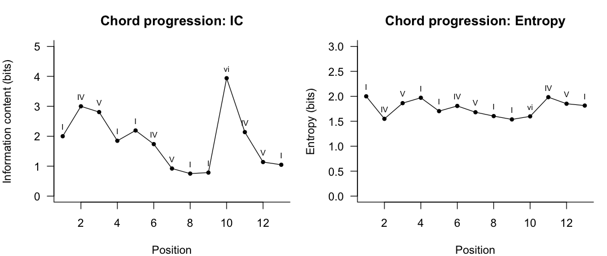
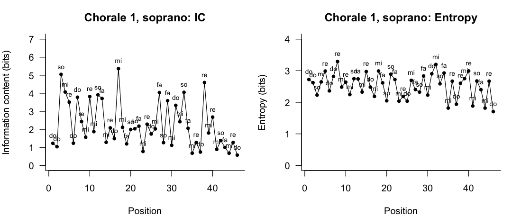
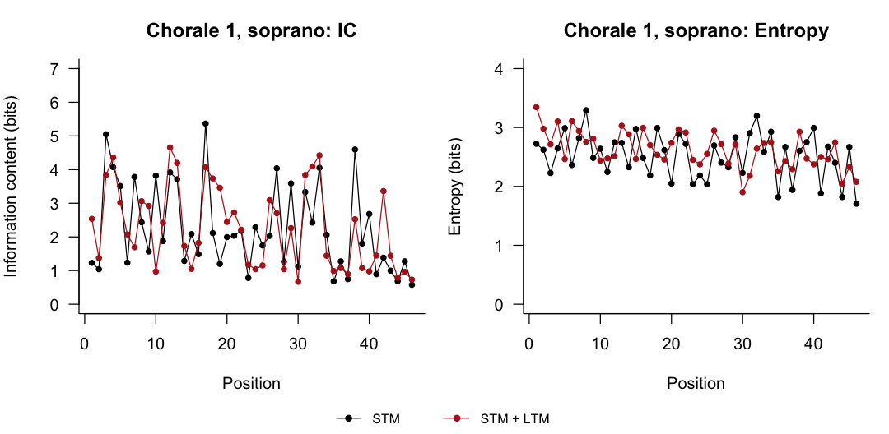
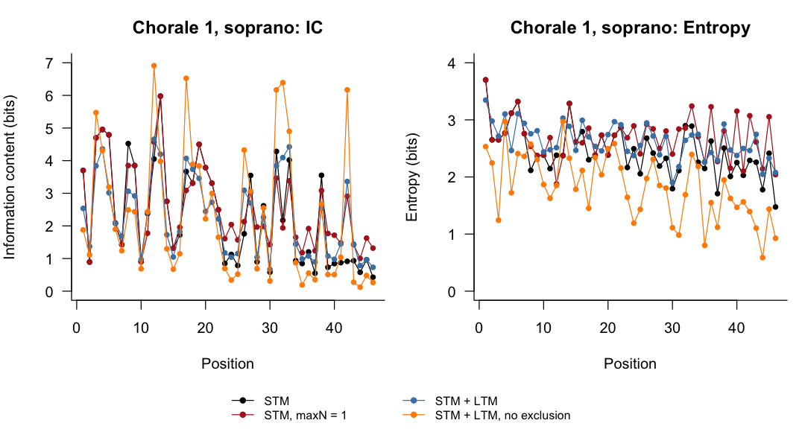

<!-- README.md is generated from README.Rmd. Please edit README.Rmd, then run rmarkdown::render("README.Rmd") (or devtools::build_readme()). -->

# PPIDyOM

**PPIDyOM** (R package `ppidyom`) measures how *surprising* and how *predictable* each event in a sequence is. An event can be any symbol: a note in a melody, a chord in a song, or something outside music, like a letter in a word. PPIDyOM uses the same prediction algorithm as the music-cognition model **IDyOM**, which is built on the statistical model **PPM**. It plugs straight into [humdrumR](https://humdrumR.ccml.gtcmt.gatech.edu), so you can run it on a whole corpus of scores in one line.

Website: <https://ppidyom.ccml.gtcmt.gatech.edu>

## What is PPIDyOM?

-   **PPM** (*Prediction by Partial Matching*; Cleary & Witten, 1984) began as a data-compression algorithm that predicts the next symbol in a sequence. It asks “the last time I saw this context, what came next?” It checks several context lengths at once (the last 1 symbol, the last 2, the last 3, …) and blends their answers into one probability for every possible next symbol. Conklin & Witten (1995) were the first to apply it to music. Peter Harrison’s [ppm](https://github.com/pmcharrison/ppm) R package implements PPM, plus *PPM-Decay*, a version in which older observations gradually fade from memory (Harrison et al., 2020).
-   **IDyOM** (*Information Dynamics of Music*; Pearce, 2005) is a widely used model of musical expectation built on PPM, written in Common Lisp ([Github](https://github.com/mtpearce/idyom)). It incorporates concepts adapted to music, including:
    -   **Long-term memory:** what a listener has learned from lots of other music (long-term musical exposure).
    -   **Short-term memory:** what they have learned so far in the current piece.
    -   **Viewpoints**: different ways of representing the same music (pitch, scale degree, interval, duration, …), each of which can be modelled.
-   **PPIDyOM** brings IDyOM’s PPM model into R and connects it to humdrumR. It aims to give the same answers as IDyOM, and as `ppm`’s non-decay model, when they are given the same settings. It is also easier to run on humdrumR data and easier to inspect.

> PPIDyOM is still being optimized. It does not (yet) include IDyOM's multiple viewpoint selection and PPM-Decay.

For each event, PPIDyOM reports:

-   **P**: the probability the model gave to the event that actually happened.
-   **IC** (*information content*, in bits) $= -\log_2 P$: how *surprising* the event was. Higher means more surprising.
-   **Entropy** (bits) $= -\sum_{e} P(e) \log_2 P(e)$, summed over every possible next event $e$: how *uncertain* the model was before the event happened. It is highest when the model spreads its probability evenly over many possible next events, and lowest when it is confident about just one.

## Installation

``` r
# install.packages("devtools")
devtools::install_github("Computational-Cognitive-Musicology-Lab/ppidyom")

# Optional, but recommended for working with music:
devtools::install_github("Computational-Cognitive-Musicology-Lab/humdrumR")
```

## A toy example: any sequence works

PPIDyOM works on any vector of symbols: chord labels, note names, words, numbers. Here is a simple chord progression, written as Roman numerals. The model starts knowing nothing and learns as it goes (`model_type = "stm"`, short-term memory only).

``` r
chords <- c("I", "IV", "V", "I",
            "I", "IV", "V", "I",
            "I", "vi", "IV", "V", "I")

res <- ppidyom(chords, model_type = "stm")
knitr::kable(res, digits = 3)
```

| index | Event |     P |    IC | Entropy |
|------:|:------|------:|------:|--------:|
|     1 | I     | 0.250 | 2.000 |   2.000 |
|     2 | IV    | 0.125 | 3.000 |   1.549 |
|     3 | V     | 0.143 | 2.807 |   1.863 |
|     4 | I     | 0.278 | 1.848 |   1.971 |
|     5 | I     | 0.219 | 2.193 |   1.703 |
|     6 | IV    | 0.300 | 1.737 |   1.807 |
|     7 | V     | 0.528 | 0.922 |   1.681 |
|     8 | I     | 0.594 | 0.752 |   1.604 |
|     9 | I     | 0.580 | 0.786 |   1.537 |
|    10 | vi    | 0.065 | 3.939 |   1.598 |
|    11 | IV    | 0.227 | 2.138 |   1.983 |
|    12 | V     | 0.455 | 1.138 |   1.851 |
|    13 | I     | 0.484 | 1.047 |   1.814 |

``` r
plot_ic_entropy(res, labels = res$Event, title = "Chord progression: ", ic_ylim = c(0, 5), ent_ylim = c(0, 3))
```



The first time through, every chord is new and surprising. The second time, the model recognises “I-IV-V-I”, so IC drops. Then `vi` breaks the pattern and IC jumps back up.

Entropy shows how *unsure* the model was before each chord, whatever chord actually came. It starts at its maximum (2 bits: four equally likely chords) and stays fairly high, because 13 chords is not much to learn from. It dips a little while I-IV-V-I repeats, and rises again after the unexpected `vi`, when the model is less sure what comes next.

## humdrumR example

humdrumR ships with a few Bach chorales. Load four of them:

``` r
library(humdrumR)

chorales <- readHumdrum(humdrumRroot, "HumdrumData/BachChorales/chor00[1-4].krn")
```

This first chorale snippet shows how the data looks in HumdrumR:

    ######################## vvv chor001.krn vvv #########################
                1:  !!!COM: Bach, Johann Sebastian
                2:  !!!CDT: 1685/02/21/-1750/07/28/
                3:  !!!OTL@@DE: Aus meines Herzens Grunde
                4:  !!!OTL@EN:      From the Depths of My Heart
                5:  !!!SCT: BWV 269
                6:  !!!PC#: 1
                7:  !!!AGN: chorale
                8:           **kern         **kern         **kern         **kern
                9:           *ICvox         *ICvox         *ICvox         *ICvox
               10:           *Ibass        *Itenor         *Ialto        *Isoprn
               11:          *I"Bass       *I"Tenor        *I"Alto     *I"Soprano
               12:        *>[A,A,B]      *>[A,A,B]      *>[A,A,B]      *>[A,A,B]
               13:     *>norep[A,B]   *>norep[A,B]   *>norep[A,B]   *>norep[A,B]
               14:              *>A            *>A            *>A            *>A
               15:          *clefF4       *clefGv2        *clefG2        *clefG2
               16:           *k[f#]         *k[f#]         *k[f#]         *k[f#]
               17:              *G:            *G:            *G:            *G:
               18:            *M3/4          *M3/4          *M3/4          *M3/4
               19:           *MM100         *MM100         *MM100         *MM100
               20:              4GG             4B             4d             4g
               21:               =1             =1             =1             =1
               22:               4G             4B             4d             2g
               23:               4E            8cL             4e              .
               24:                .            8BJ              .              .
               25:              4F#             4A             4d            4dd
               26:               =2             =2             =2             =2
               27:               4G             4G             2d            4.b
               28:               4D            4F#              .              .
               29:                .              .              .             8a
               30:               4E             4G             4B             4g
               31:               =3             =3             =3             =3
               32:               4C            8cL            8eL            4.g
               33:                .            8BJ             8d              .
               34:             8BBL             4c             8e              .
               35:             8AAJ              .           8f#J             8a
               36:              4GG             4d             4g             4b
               37:               =4             =4             =4             =4
               38:              2D;            2d;           2f#;            2a;
               39:              4GG             4d             4g             4b
               40:               =5             =5             =5             =5
               41:             4FF#             4A             4d            2dd
               42:              4GG             4B             4e              .
               43:              4AA             4c            4f#            4cc
               44:               =6             =6             =6             =6
               45:              4BB             4d             2g             4b
               46:               4C             4e              .             2a
               47:               4D            8dL            4f#              .
               48:                .            8cJ              .              .
               49:               =7             =7             =7             =7
               50:             2GG;            2B;            2d;            2g;
    ######################## ^^^ chor001.krn ^^^ #########################

       Data fields: 
                *Token :: character

Each column (*spine*) is one voice: bass, tenor, alto and soprano. Each note is written in `**kern`, which encodes pitch and rhythm.

The quickest way to model it is to pick a viewpoint and pipe straight into `ppidyom()`, e.g. `chorales |> solfa(simple = TRUE) |> ppidyom()`. This handles pieces and voices for you and adds an `ICppidyom` field to the score. That shortcut currently stores IC only, so to keep **both IC and Entropy** we call `ppidyom()` inside `within()` and pass the groups ourselves:

``` r
stm <- chorales |>
  # viewpoint: scale degree, no octave
  solfa(simple = TRUE) |>
  within(Res <- ppidyom(Solfa, model_type = "stm"),
         IC <- Res$IC, Entropy <- Res$Entropy)
```

`stm` is still a humdrumR corpus, now with `IC` and `Entropy` fields next to every note. Here are the first notes of the soprano (spine 4) in chorale 1:

``` r
tab <- pull_data.table(stm, Piece, Spine, Solfa, IC, Entropy)
sop <- tab[Piece == 1 & Spine == 4 & !is.na(IC)]
knitr::kable(head(sop, 10), digits = 3)
```

| Piece | Spine | Solfa |    IC | Entropy |
|------:|------:|:------|------:|--------:|
|     1 |     4 | do    | 1.229 |   2.724 |
|     1 |     4 | do    | 1.040 |   2.622 |
|     1 |     4 | so    | 5.048 |   2.228 |
|     1 |     4 | mi    | 4.074 |   2.645 |
|     1 |     4 | re    | 3.510 |   2.989 |
|     1 |     4 | do    | 1.234 |   2.363 |
|     1 |     4 | do    | 3.781 |   2.820 |
|     1 |     4 | re    | 2.434 |   3.293 |
|     1 |     4 | mi    | 1.567 |   2.483 |
|     1 |     4 | re    | 3.822 |   2.639 |

``` r
plot_ic_entropy(sop, labels = sop$Solfa, title = "Chorale 1, soprano: ")
```



## Long-term + short-term memory

A listener doesn’t hear each chorale fresh: they bring knowledge from other music. With `model_type = "both"` (the default), PPIDyOM blends two models:

-   **Long-term (LTM):** trained on the *other* pieces in the corpus. Each piece is held out in turn, so the model is never tested on music it was trained on (“leave-one-out”).
-   **Short-term (STM):** learns from the current voice as it goes, like the toy example above.

To keep this example fast, we use the four chorales loaded above as the whole training corpus. (The current version is not yet fast enough for large corpora.)

``` r
both <- chorales |>
  solfa(simple = TRUE) |>
  within(Res <- ppidyom(Solfa, model_type = "both", maxN = 3,
                      # each voice is one sequence
                       shortTermGroups = list(Spine, Piece),   
                       # each chorale is one piece
                       longTermGroups = list(Piece)),
         IC <- Res$IC, Entropy <- Res$Entropy)

tab_both <- pull_data.table(both, Piece, Spine, Solfa, IC, Entropy)

# Average per chorale: short-term only vs. long-term + short-term
cmp <- merge(tab[, .(`IC: STM` = mean(IC, na.rm = TRUE),
                     `Entropy: STM` = mean(Entropy, na.rm = TRUE)), by = Piece],
             tab_both[, .(`IC: STM + LTM`  = mean(IC, na.rm = TRUE),
                          `Entropy: STM + LTM` = mean(Entropy, na.rm = TRUE)), by = Piece])
knitr::kable(cmp[, c(1, 2, 4, 3, 5)], digits = 2, caption = "Mean IC and Entropy (bits) per chorale")
```

| Piece | IC: STM | IC: STM + LTM | Entropy: STM | Entropy: STM + LTM |
|------:|--------:|--------------:|-------------:|-------------------:|
|     1 |    2.48 |          2.31 |         2.58 |               2.73 |
|     2 |    2.62 |          2.56 |         2.76 |               2.82 |
|     3 |    2.97 |          3.24 |         3.11 |               2.78 |
|     4 |    2.99 |          2.84 |         3.21 |               2.87 |

Mean IC and Entropy (bits) per chorale

``` r
sop_both <- tab_both[Piece == 1 & Spine == 4 & !is.na(IC)]
plot_ic_entropy(list("STM" = sop, "STM + LTM" = sop_both), title = "Chorale 1, soprano: ")
```



Adding the long-term model lowers the average IC for chorales 1, 2 and 4, but not for chorale 3 (3.20 → 3.24). The long-term model learns from only the other three chorales, so it helps only as far as the test chorale resembles them.

Average entropy stays about the same (within 0.1 bits). So the blended model is not more certain overall, but it puts more of its probability on the notes that actually occur, which is why IC drops.

## Parameters

All parameters have defaults, so you only need to set the ones you want to change. They work the same way on plain vectors and on humdrumR data.

| Parameter                        | What it does                                                                                                                                                                                             | Default                                                                              | Example                                          |
|----------------------------------|----------------------------------------------------------------------------------------------------------------------------------------------------------------------------------------------------------|--------------------------------------------------------------------------------------|--------------------------------------------------|
| `...`                            | The sequence(s) to model. Pass several vectors to combine them into one symbol per event (e.g. pitch + rhythm).                                                                                          | —                                                                                    | `ppidyom(pitch, rhythm)`                         |
| `maxN`                           | The longest context, in events, that the model looks back over.                                                                                                                                          | `5`                                                                                  | `maxN = 3`                                       |
| `alphabet`                       | Every symbol that *could* occur, including ones never seen.                                                                                                                                              | unique values of the input                                                           | `alphabet = letters`                             |
| `model_type`                     | Which memory to use: `"stm"` (current sequence only), `"ltm"` (other pieces only), `"both"` (blend of the two). `"ltm+"` and `"both+"` also let the long-term model keep learning during the test piece. | `"both"`                                                                             | `model_type = "stm"`                             |
| `ppm_type`                       | How context lengths are combined: `"interpolation"` blends all of them (Bunton, 1996); `"backoff"` uses the longest one that matches.                                                                    | `"interpolation"`                                                                    | `ppm_type = "backoff"`                           |
| `shortTermArgs$lambda`           | *Escape method*: how much probability to reserve for symbols not yet seen in a context. One of `"A"`, `"B"`, `"C"`, `"D"`, `"X"`.                                                                        | `"C"`                                                                                | `shortTermArgs = list(lambda = "D")`             |
| `shortTermArgs$exclusion`        | **When predicting:** a shorter context gives its leftover (escape) probability only to symbols the longer context hasn’t already predicted.                                                              | `TRUE`                                                                               | `shortTermArgs = list(exclusion = FALSE)`        |
| `shortTermArgs$update_exclusion` | **When learning:** a new event is counted only in the longest contexts that matched, not in every shorter one too.                                                                                       | `TRUE`                                                                               | `shortTermArgs = list(update_exclusion = FALSE)` |
| `longTermArgs`                   | The same settings for the long-term model, plus `start_token`: whether to learn from the very start of each sequence.                                                                                    | `lambda = "C"`, `exclusion = TRUE`, `update_exclusion = FALSE`, `start_token = TRUE` | `longTermArgs = list(start_token = FALSE)`       |
| `longTermGroups`                 | Which events belong to the same piece, used for leave-one-out training. Set automatically for humdrumR.                                                                                                  | one group                                                                            | `longTermGroups = list(piece_id)`                |
| `shortTermGroups`                | Which events belong to the same sequence (e.g. voice). The short-term model restarts for each one. Set automatically for humdrumR.                                                                       | one group                                                                            | `shortTermGroups = list(voice_id)`               |
| `b`                              | When blending STM and LTM, how strongly to favour the more confident model.                                                                                                                              | `1`                                                                                  | `b = 7`                                          |
| `idyom_base`                     | Use IDyOM’s exact formula for the fallback “uniform guess”, instead of `ppm`’s.                                                                                                                          | `FALSE`                                                                              | `idyom_base = TRUE`                              |

### Examples with parameters

Here are the four chorales again under different settings. `run()` is the same `within()` call as above, with the settings passed through `...`:

``` r
run <- function(..., maxN = 3) {
  chorales |>
    solfa(simple = TRUE) |>
    within(Res <- ppidyom(Solfa, maxN = maxN, ...,
                         shortTermGroups = list(Spine, Piece),
                         longTermGroups  = list(Piece)),
           IC <- Res$IC, Entropy <- Res$Entropy) |>
    pull_data.table(Piece, Spine, Solfa, IC, Entropy)
}

runs <- list(
  "STM"           = run(model_type = "stm"),
  "STM, maxN = 1" = run(model_type = "stm", maxN = 1),
  "STM + LTM"     = run(model_type = "both"),
  "STM + LTM, no exclusion" =
    run(model_type = "both",
        shortTermArgs = list(exclusion = FALSE),
        longTermArgs  = list(exclusion = FALSE))
)

summary_tab <- data.table(
  Setting        = names(runs),
  `Mean IC`      = sapply(runs, function(r) mean(r$IC, na.rm = TRUE)),
  `Mean Entropy` = sapply(runs, function(r) mean(r$Entropy, na.rm = TRUE))
)
knitr::kable(summary_tab, digits = 2, caption = "All four chorales, all voices")
```

| Setting                 | Mean IC | Mean Entropy |
|:------------------------|--------:|-------------:|
| STM                     |    3.08 |         2.81 |
| STM, maxN = 1           |    3.08 |         2.94 |
| STM + LTM               |    2.71 |         2.80 |
| STM + LTM, no exclusion |    2.90 |         2.04 |

All four chorales, all voices

``` r
sop_runs <- lapply(runs, function(r) r[Piece == 1 & Spine == 4 & !is.na(IC)])
plot_ic_entropy(sop_runs, title = "Chorale 1, soprano: ")
```



-   **STM + LTM** lowers the average IC (3.08 → 2.71), while entropy barely changes.

-   **`maxN = 1`** only looks at the previous note. The average IC stays the same here, but entropy goes up (2.81 → 2.94): without longer contexts, the model is less sure what comes next.

-   **Turning off exclusion** (last row) makes predictions sharper. With exclusion, a shorter context gives its leftover probability only to notes the longer context hasn’t predicted. Without it, every context length adds to the same familiar notes. Probability piles onto fewer notes, so **entropy drops** (2.80 → 2.04).

    But **IC goes up** (2.71 → 2.90). Because the familiar notes take most of the probability, every other note is left with very little. So when a less familiar note does come, it is very surprising: those are the tall orange spikes in the IC plot. On familiar notes, IC drops only a little, so these few big surprises raise the average.

## Learn more

-   `?ppidyom` for the full function reference.
-   The [website](https://ppidyom.ccml.gtcmt.gatech.edu) has longer articles on the algorithm, its defaults, how parameters map onto IDyOM and `ppm`, and more humdrumR examples.

## References

-   Bunton, S. (1996). *On-line stochastic processes in data compression*. PhD dissertation, University of Washington.
-   Cleary, J. G., & Witten, I. H. (1984). Data compression using adaptive coding and partial string matching. *IEEE Transactions on Communications, 32*(4), 396–402. <https://doi.org/10.1109/TCOM.1984.1096090>
-   Conklin, D., & Witten, I. H. (1995). Multiple viewpoint systems for music prediction. *Journal of New Music Research, 24*(1), 51–73. <https://doi.org/10.1080/09298219508570672>
-   Harrison, P. M. C., Bianco, R., Chait, M., & Pearce, M. T. (2020). PPM-Decay: A computational model of auditory prediction with memory decay. *PLOS Computational Biology, 16*(11), e1008304. <https://doi.org/10.1371/journal.pcbi.1008304>
-   Pearce, M. T. (2005). *The construction and evaluation of statistical models of melodic structure in music perception and composition*. PhD thesis, City University, London.
